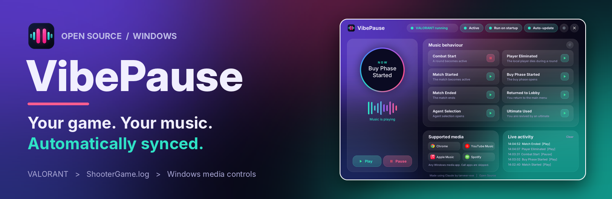
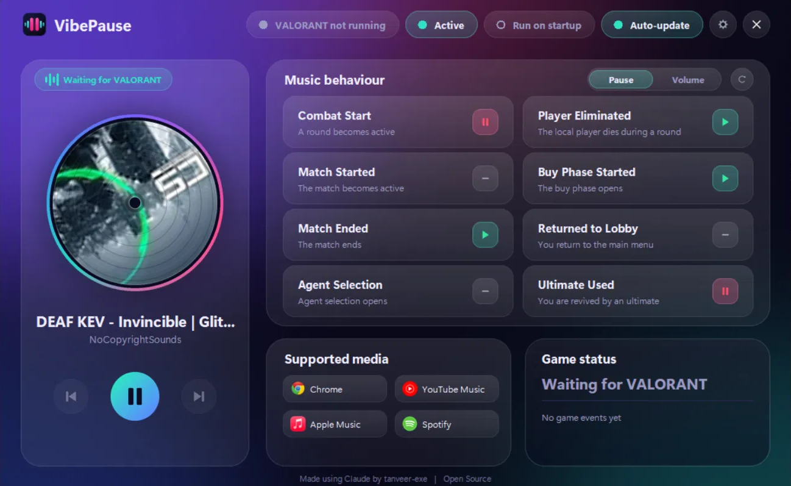
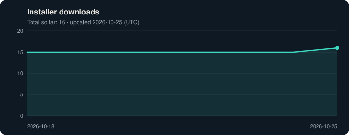

  

<h1 align="center">VibePause</h1>

<b>Your game. Your music. Automatically synced.</b>

  Get fragged mid-song one too many times? VibePause pauses your music the instant a VALORANT round starts and brings it back when you die, buy, or head back to the lobby &mdash; no more diving for the volume mixer.

  <b>No overlay. No game injection. No memory reading. No gameplay automation.</b> 
  VibePause never touches VALORANT &mdash; it reads a local log file, uses Windows' built-in OCR on your screen to spot eliminations (processed in memory, never saved or sent anywhere), and controls Windows media playback.

  
  
  
  
  
  
  
  

  

---

## Install

1. Open the **[Releases page](https://github.com/Tanveer-exe/VibePause/releases)**.
2. Download **`VibePause_Setup.exe`** from the latest release.
3. Run the installer.

VibePause installs for your user account, so administrator rights are not required.

### Installing with Windows SmartScreen

VibePause is a new project and the installer is **not code-signed yet**. We plan to apply for free code signing from the [SignPath Foundation](https://signpath.org/) once the project has built up a track record, so Windows may show a warning for now. Only continue if you downloaded the installer from this repository's Releases page or the [official website](https://tanveer-exe.github.io/VibePause/).

1. Run `VibePause_Setup.exe`. If your browser says the file isn't commonly downloaded, open the download's menu (...), choose **Keep**, then **Keep anyway**. The wording differs between browsers.
2. If Windows shows **Windows protected your PC**, click **More info**. The publisher appears as "Unknown" because the installer is not signed yet.
3. Click **Run anyway**.

**Checking your download:** each release also includes `VibePause_Setup.exe.sha256`. In PowerShell, `Get-FileHash .\VibePause_Setup.exe` should show the same value.

See the [code signing policy](CODE_SIGNING_POLICY.md) for the status of code signing.

After installation, launch VibePause, start your preferred Windows media app, and launch VALORANT.

---

## Features

### Automatic music control

VibePause can automatically play or pause your music based on VALORANT events.

Supported events include:

- Game start
- Combat phase
- Buy phase
- Player eliminated (detected using Windows' built-in OCR)
- Match finish
- Returning to the lobby
- Character select
- Player revival

Each event can be configured independently as:

- **Play**
- **Pause**
- **None**

You can also reset all events to their default settings.

### Now playing, with media controls

The main window shows what's currently playing, with its artwork, title and artist, plus **Previous**, **Play/Pause** and **Next** buttons so you can control your music without leaving VibePause. A small status pill next to it shows what VibePause is doing (waiting for VALORANT, in a match, paused for your match, and so on), so you always know why your music just changed.

### Pause mode and Volume mode

A switch at the top of the **Music behaviour** card changes how events control your music:

- **Pause** (default): each event plays, pauses, or does nothing, as above.
- **Volume**: each event sets a volume from 0% (silent) to 100% with a slider. Click the percentage to leave an event unchanged. The music keeps playing and only its volume changes. By default, events that pause in Pause mode drop to 20%, and the rest go to 100%.

Volume mode changes the same per-app volume you see in the Windows volume mixer. It never changes VALORANT, Riot software, voice chat or call apps, and it puts volumes back when you switch to Pause mode or exit VibePause.

### Supported media

VibePause works with **Windows media apps that support Windows' standard media controls**.

This means it can work with compatible music players, browsers, and other media applications without needing direct integration with each individual app.

### System tray

VibePause can run quietly in the Windows system tray, with a switch to turn it on or off.

### Settings

VibePause provides settings for:

- Language, chosen on first start (English, Español, Português (Brasil), Français, Deutsch, Italiano, Polski, Türkçe, Русский, 日本語, 한국어, 简体中文, 繁體中文, Bahasa Indonesia, Tiếng Việt)
- Event delay
- Close button behavior
- Start with Windows
- Automatic update checks
- An optional hotkey to turn VibePause on or off (none by default, and you can clear it at any time)
- Open log folder and Copy diagnostics buttons, to make bug reports easier

Settings are saved locally.

**Translations:** the translations are machine-made and have not been checked by native speakers, so some wording may be off. Each language is a small file in `src/lang` (for example `fr.json`), and corrections are welcome as pull requests. Any text missing from a file is shown in English. The Terms and Privacy Policy are shown in English only.

### Updates

Open **Settings** and select **Check for updates** to update manually, or turn on automatic checks so VibePause lets you know when a new version is out.

---

## Does VibePause modify VALORANT?

No.

VibePause does **not**:

- Inject DLLs into VALORANT
- Read VALORANT process memory
- Modify VALORANT files or game assets
- Automate gameplay
- Send gameplay input
- Interact with Vanguard
- Modify network packets
- Provide gameplay advantages
- Draw an in-game overlay

VibePause is an external companion application.

---

## Code signing policy

VibePause is building a track record and plans to apply for free code signing from the [SignPath Foundation](https://signpath.org/). Until then, the installer is not signed (see [Installing with Windows SmartScreen](#installing-with-windows-smartscreen)).

- Committers, reviewers and approvers: [tanveer-exe](https://github.com/Tanveer-exe)
- Privacy policy: see the [Privacy Policy](src/PRIVACY_POLICY.md). VibePause collects no personal data and only contacts GitHub, to check for and download updates.
- Full details: [CODE_SIGNING_POLICY.md](CODE_SIGNING_POLICY.md)

  

## Privacy

VibePause runs locally and does not require:

- Riot account credentials
- Authentication tokens
- Game memory
- Gameplay input
- Network traffic access

The application only uses network access for checking and downloading updates from GitHub.

Your settings and a local `error.log` (technical error details, never uploaded) are stored in `Documents\VibePause`. The now-playing card shows the title, artist and artwork that your media app shares with Windows; they stay in memory and are never saved or sent anywhere. The [website](https://tanveer-exe.github.io/VibePause/) sets no cookies and has no analytics or ads.

See the full [Privacy Policy](src/PRIVACY_POLICY.md), [Terms and Conditions](src/TERMS_AND_CONDITIONS.md), [Cookie Policy](COOKIE_POLICY.md) and [third-party notices](src/THIRD_PARTY_NOTICES.md). The same documents are on the website: [Privacy](https://tanveer-exe.github.io/VibePause/privacy.html), [Terms](https://tanveer-exe.github.io/VibePause/terms.html), [Cookies](https://tanveer-exe.github.io/VibePause/cookies.html).

---

## Disclaimer

> **Please read this before using VibePause.**

VibePause is an independent community project.

The developer is not responsible for any account action, restriction, suspension, ban, compatibility issue, data loss, or other consequence resulting from the use of this software.

VibePause is:

- **Not affiliated with, endorsed by, or sponsored by Riot Games or VALORANT**
- **Not associated with any third-party media applications**

VibePause isn't endorsed by Riot Games and doesn't reflect the views or opinions of Riot Games or anyone officially involved in producing or managing Riot Games properties. Riot Games can change its rules at any time, so you use VibePause at your own risk.

VALORANT and its related systems may change at any time. Compatibility is not guaranteed across all future versions of VALORANT or Windows.

If you experience a problem, please open an issue on GitHub with details about what happened.

---

## Built with Claude

VibePause was developed through human and AI collaboration, with **Claude** used as a coding partner throughout development.

The project was tested and refined on a real Windows PC.

---

## Tech stack

- Python and Tkinter
- pystray and Pillow
- Windows Runtime media controls
- PyInstaller
- Inno Setup
- GitHub Actions

---

## Open source

VibePause is an open-source project. You are welcome to read the code, fork the project, report bugs, suggest improvements, or contribute changes.

The code lives in the [`src`](src) folder.

### Build from source

1. Install Python 3.11 on Windows.
2. In the `src` folder, run `pip install -r requirements.txt pyinstaller==6.22.3`.
3. Run `python VibePause.pyw` to start the app, or `pyinstaller --clean --noconfirm VibePause.spec` to build it.
4. To build the installer, compile `src/installer/VibePause.iss` with Inno Setup 6 after copying `LICENSE` into `src`.

If you find a problem, please [open an issue](https://github.com/Tanveer-exe/VibePause/issues/new/choose). In VibePause, **Settings > Copy diagnostics** copies the details the form asks for.

---

## Trademarks

VALORANT and Riot Games are trademarks or registered trademarks of Riot Games, Inc. Other product names, applications, logos, and trademarks mentioned in this project (including the names Chrome, YouTube Music, Apple Music and Spotify, which are used only to show which apps VibePause can work with) belong to their respective owners.

VibePause does not claim ownership of any third-party names, logos, or applications.

---

## Accessibility

The website is built to work with a keyboard and screen readers. The Windows app uses a custom-drawn window that is mostly mouse-operated and is not yet fully usable with a keyboard or screen reader. If something blocks you, please [open an issue](https://github.com/Tanveer-exe/VibePause/issues/new/choose).

## Donations

VibePause is free and no feature depends on a donation. Donations on Ko-fi are voluntary gifts; see the [Terms and Conditions](src/TERMS_AND_CONDITIONS.md) for how they and refunds are handled.

---

## Creator

**Made by tanveer-exe**, together with **Claude**.

## License

Copyright (C) 2026 tanveer-exe

VibePause is released under the **[GNU General Public License v3.0](LICENSE)**.

You can use, copy, modify, and share the software. If you share a modified version, you must also share its source code under the same license.

The names and logos of VALORANT, Riot Games, and third-party applications are not covered by this license.

---

<b>Your game. Your music. Automatically synced.</b>

