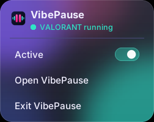

  

<h1 align="center">VibePause</h1>

<b>Your game. Your music. Automatically synced.</b>

  A lightweight Windows companion for <b>VALORANT</b> that automatically controls your music based on what is happening in the match.

  
  
  
  
  
  

  <b>No overlay. No game injection. No memory reading. No gameplay automation.</b> 
  VibePause runs locally and controls Windows media playback.

  

---

## Install

1. Open the **[Releases page](https://github.com/Tanveer-exe/VibePause/releases)**.
2. Download **`VibePause_Setup.exe`** from the latest release.
3. Run the installer.

VibePause installs for your user account, so administrator rights are not required.

> **Windows SmartScreen:** The installer is currently not code-signed, so Windows may display "Windows protected your PC". Click **More info**, then **Run anyway** if you trust the application.

After installation, launch VibePause, start your preferred Windows media app, and launch VALORANT.

---

## Features

### Automatic music control

VibePause can automatically play or pause your music based on VALORANT events.

Supported events include:

- Game start
- Combat phase
- Buy phase
- Player death
- Match finish
- Returning to the lobby
- Character select
- Player revival

Each event can be configured independently as:

- **Play**
- **Pause**
- **None**

You can also reset all events to their default settings.

### Supported media

VibePause works with **Windows media apps that support Windows' standard media controls**.

This means it can work with compatible music players, browsers, and other media applications without needing direct integration with each individual app.

### System tray

VibePause can run quietly in the Windows system tray.

From the tray menu you can:

- Open VibePause
- Turn VibePause on or off with the Active switch
- Exit VibePause

  

You can also choose whether closing the window sends VibePause to the tray or exits the application.

### Start with Windows

You can optionally start VibePause automatically when Windows starts.

When enabled, VibePause launches in the system tray and runs in the background.

### Settings

VibePause provides settings for:

- Event delay
- Close button behavior
- Start with Windows
- Automatic update checks

Settings are saved locally.

### Updates

Open **Settings** and select **Check for updates**.

If a newer version is available, VibePause will ask for confirmation before downloading and installing it.

If you are already running the latest version, VibePause will let you know.

Update checks use the public GitHub API to check for releases. No other information is sent as part of the update check.

---

## Does VibePause modify VALORANT?

No.

VibePause does **not**:

- Inject DLLs into VALORANT
- Read VALORANT process memory
- Modify VALORANT files or game assets
- Automate gameplay
- Send gameplay input
- Interact with Vanguard
- Modify network packets
- Provide gameplay advantages
- Draw an in-game overlay

VibePause is an external companion application.

---

## Privacy

VibePause runs locally and does not require:

- Riot account credentials
- Authentication tokens
- Game memory
- Gameplay input
- Network traffic access

The application only uses network access for checking and downloading updates from GitHub.

---

## Disclaimer

> **Please read this before using VibePause.**

VibePause is an independent community project.

The developer is not responsible for any account action, restriction, suspension, ban, compatibility issue, data loss, or other consequence resulting from the use of this software.

VibePause is:

- **Not affiliated with, endorsed by, or sponsored by Riot Games or VALORANT**
- **Not associated with any third-party media applications**

VALORANT and its related systems may change at any time. Compatibility is not guaranteed across all future versions of VALORANT or Windows.

If you experience a problem, please open an issue on GitHub with details about what happened.

---

## Built with Claude

VibePause was developed through human and AI collaboration, with **Claude** used as a coding partner throughout development.

The project was tested and refined on a real Windows PC.

---

## Tech stack

- Python and Tkinter
- pystray and Pillow
- Windows Runtime media controls
- PyInstaller
- Inno Setup
- GitHub Actions

---

## Open source

VibePause is an open-source project. You are welcome to read the code, fork the project, report bugs, suggest improvements, or contribute changes.

The code lives in the [`src`](src) folder.

### Build from source

1. Install Python 3.11 on Windows.
2. In the `src` folder, run `pip install -r requirements.txt pyinstaller==6.22.3`.
3. Run `python VibePause.pyw` to start the app, or `pyinstaller --clean --noconfirm VibePause.spec` to build it.
4. To build the installer, compile `src/installer/VibePause.iss` with Inno Setup 6 after copying `LICENSE` into `src`.

If you find a problem, please open an issue on GitHub.

---

## Trademarks

VALORANT and Riot Games are trademarks of Riot Games, Inc. Other product names, applications, logos, and trademarks mentioned in this project belong to their respective owners.

VibePause does not claim ownership of any third-party names, logos, or applications.

---

## Creator

**Made by tanveer-exe**, together with **Claude**.

## License

VibePause is released under the **[MIT License](LICENSE)**.

You can use, copy, modify, and distribute the software, including in your own projects, as long as you retain the copyright notice.

The names and logos of VALORANT, Riot Games, and third-party applications are not covered by this license.

---

<b>Your game. Your music. Automatically synced.</b>

